# OpenEDR to ELK Stack Log Forwarding

Forward endpoint telemetry from **OpenEDR** on a Windows machine to the **ELK Stack** (Elasticsearch + Kibana) using **Filebeat**.

   

## Overview

OpenEDR is an endpoint detection agent for Windows. It records process activity and writes it as JSON, one event per line, to a local folder. It has no built-in option to send logs to a SIEM such as the ELK Stack, so Filebeat reads those files and ships them to Elasticsearch, and Kibana is used to view them.

```
OpenEDR agent -> JSON log file -> Filebeat -> Elasticsearch -> Kibana
```

## Lab Setup

| VM | OS | Software |
|---|---|---|
| **VM1** | Ubuntu 24.04.3 | Elasticsearch 9.5.5, Kibana |
| **VM2** | Windows 11 | OpenEDR 2.5.1, Filebeat 9.5.5 |

Both VMs must be on the same network. In this lab VM1 is `192.168.41.131` and VM2 is `192.168.41.135`.

---

# Part 1: Install ELK on VM1

This follows the official Elastic guide for installing Elasticsearch with a Debian package.

## Step 1: Add the Elastic repository

```bash
wget -qO - https://artifacts.elastic.co/GPG-KEY-elasticsearch | sudo gpg --dearmor -o /usr/share/keyrings/elasticsearch-keyring.gpg
sudo apt-get install apt-transport-https
echo "deb [signed-by=/usr/share/keyrings/elasticsearch-keyring.gpg] https://artifacts.elastic.co/packages/9.x/apt stable main" | sudo tee /etc/apt/sources.list.d/elastic-9.x.list
```

## Step 2: Install Elasticsearch

```bash
sudo apt-get update && sudo apt-get install elasticsearch
```

Security is configured automatically during installation (TLS certificates and the `elastic` user).

## Step 3: Start it automatically with systemd

```bash
sudo /bin/systemctl daemon-reload
sudo /bin/systemctl enable elasticsearch.service
sudo systemctl start elasticsearch.service
```

## Step 4: Set the password for the elastic user

```bash
sudo /usr/share/elasticsearch/bin/elasticsearch-reset-password -u elastic
export ELASTIC_PASSWORD="<the password it prints>"
```

## Step 5: Verify that it is running

```bash
sudo curl --cacert /etc/elasticsearch/certs/http_ca.crt -u elastic:$ELASTIC_PASSWORD https://localhost:9200
```

The response is a JSON block with the cluster name, the version number and the tagline `"You Know, for Search"`.

**Screenshot:** Elasticsearch response


Then check the service status:

```bash
sudo systemctl status elasticsearch
```

**Screenshot:** the `active (running)` status

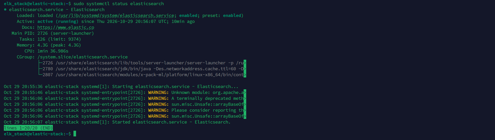

## Step 6: Note the CA fingerprint

Filebeat uses this later to trust Elasticsearch.

```bash
sudo openssl x509 -fingerprint -sha256 -in /etc/elasticsearch/certs/http_ca.crt
```

Remove the colons and use lowercase. Example format of the final value:

```
b0d016af6b3317e5fa351da076c8b4cb6a9aefcf011b0d5dd1ef4aa6f6a1f851
```

Your value will be different because every installation generates its own certificate.

## Step 7: Install Kibana

```bash
sudo apt-get install kibana
sudo /usr/share/elasticsearch/bin/elasticsearch-create-enrollment-token -s kibana
```

In `/etc/kibana/kibana.yml`, set the following so Kibana can be opened from another machine:

```yaml
server.host: "0.0.0.0"
```

Then start it:

```bash
sudo systemctl daemon-reload
sudo systemctl enable kibana
sudo systemctl start kibana
```

Open `http://<VM1 IP>:5601`, paste the enrollment token, enter the verification code from the command below, and log in as `elastic`:

```bash
sudo /usr/share/kibana/bin/kibana-verification-code
```

**Screenshot:** Kibana home page after login

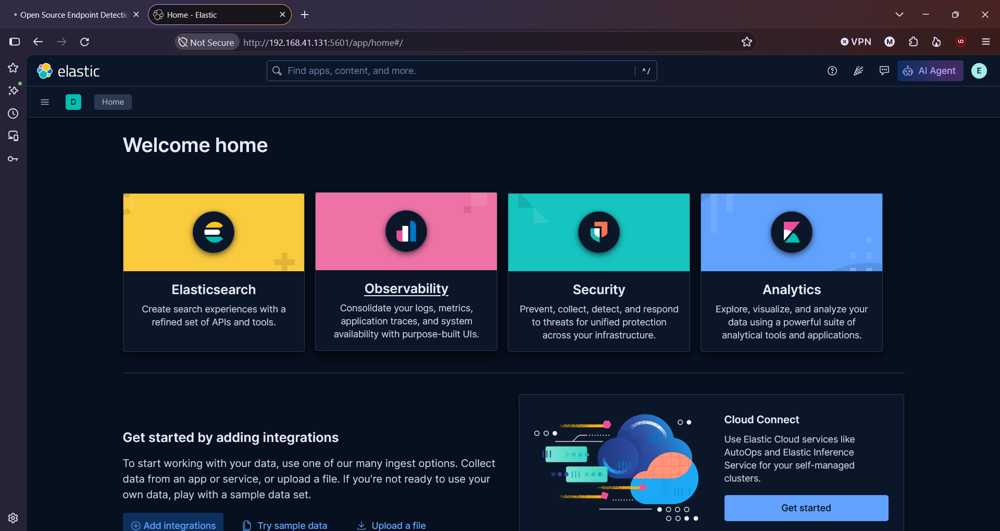

---

# Part 2: Install OpenEDR and Filebeat on VM2

## Step 1: Install OpenEDR

1. Download `OpenEDR-Installation-2.5.1-Win64.msi` from the Assets section of the official release page: <https://github.com/ComodoSecurity/openedr/releases>
2. Run the installer as Administrator and reboot.
3. Make sure the OpenEDR service (`edrsvc`) starts automatically and is running (PowerShell as Administrator):

```powershell
Set-Service -Name edrsvc -StartupType Automatic
Start-Service edrsvc
Get-Service edrsvc
```

**Screenshot:** service status showing `Running`

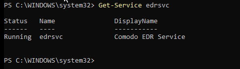

4. Generate some activity (open cmd and PowerShell, run `whoami` and `ipconfig`, create files) and confirm that OpenEDR is writing events:

```powershell
Get-ChildItem C:\ProgramData\edrsvc\log\output_events | Select Name, Length, LastWriteTime
Get-Content C:\ProgramData\edrsvc\log\output_events\*.log -TotalCount 1
```

Each line is one JSON event with fields such as `childProcess.imagepath`, `childProcess.cmdLine`, `deviceName` and `sessionUser`.

**Screenshot:** OpenEDR log files and a sample event

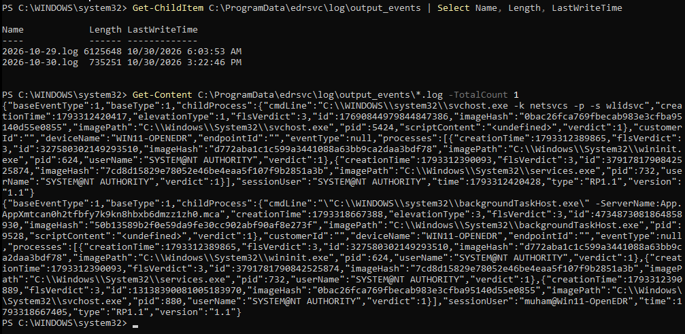

## Step 2: Check connectivity from VM2 to Elasticsearch

```powershell
Test-NetConnection 192.168.41.131 -Port 9200
```

`TcpTestSucceeded : True` confirms that VM2 can reach Elasticsearch.

**Screenshot:** the `Test-NetConnection` result

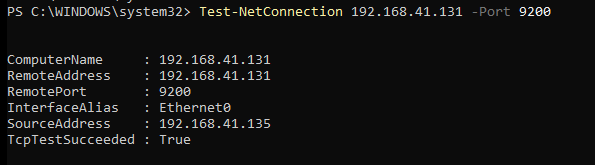

## Step 3: Install Filebeat on VM2

Download the **Windows ZIP x86_64** package of Filebeat 9.5.5 from <https://www.elastic.co/downloads/beats/filebeat> and extract it:

```powershell
Expand-Archive "$env:USERPROFILE\Downloads\filebeat-9.5.5-windows-x86_64.zip" -DestinationPath "C:\Program Files"
Rename-Item "C:\Program Files\filebeat-9.5.5-windows-x86_64" "C:\Program Files\Filebeat"
```

## Step 4: Configure Filebeat

Replace `C:\Program Files\Filebeat\filebeat.yml` with this configuration:

```yaml
filebeat.inputs:
  - type: filestream
    id: openedr-events
    enabled: true
    paths:
      - C:/ProgramData/edrsvc/log/output_events/*.log
    parsers:
      - ndjson:
          target: "openedr"
          add_error_key: true
    fields:
      source_product: openedr
    fields_under_root: true

processors:
  - drop_fields:
      fields: ["openedr.processes", "openedr.childProcess.id"]
      ignore_missing: true

output.elasticsearch:
  hosts: ["https://192.168.41.131:9200"]
  username: "elastic"
  password: "<elastic-password>"
  ssl.ca_trusted_fingerprint: "<ca-fingerprint-from-part-1-step-6>"

setup.ilm.enabled: true
logging.level: info
```

> Replace `<elastic-password>` and `<ca-fingerprint-from-part-1-step-6>` with your own values. Never commit a real password to GitHub.

**Screenshot:** `filebeat.yml` (hide the password before taking or sharing the screenshot)

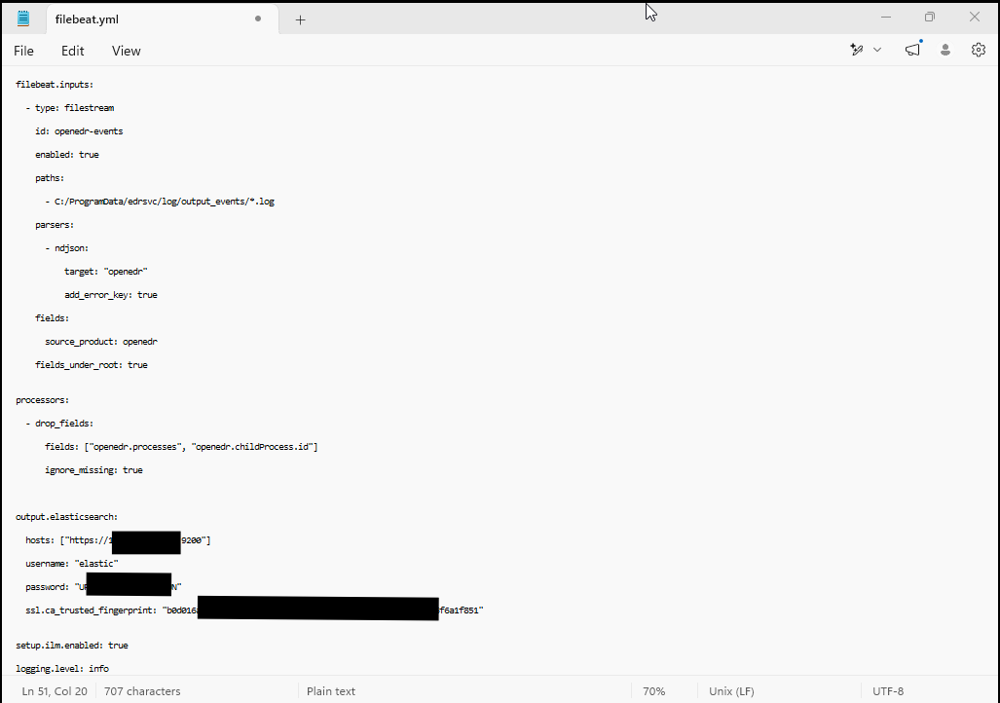

### What each part does

- **filestream input:** reads every log file in OpenEDR's `output_events` folder.
- **ndjson parser:** each line is a JSON object, so Filebeat parses it into fields under `openedr.*`.
- **drop_fields processor:** OpenEDR's internal process IDs are 64-bit numbers larger than Elasticsearch can store as a `long`, so indexing failed. The fields `openedr.processes` and `openedr.childProcess.id` are removed. The child process path, command line, PID and user are kept.
  - **Trade-off:** the parent-process chain (for example `svchost` -> `services` -> `wininit`) is no longer indexed. A `script` processor that converts those IDs to strings would keep it.
- **output.elasticsearch:** sends events to Elasticsearch over TLS, trusting it by the CA fingerprint from Part 1, Step 6.

### Test the configuration and connection

```powershell
cd "C:\Program Files\Filebeat"
.\filebeat.exe test config -c .\filebeat.yml
.\filebeat.exe test output -c .\filebeat.yml
```

The expected result is `Config OK`, then a successful TLS handshake, `talk to server... OK` and `version: 9.5.5`.

**Screenshot:** Filebeat config and output tests

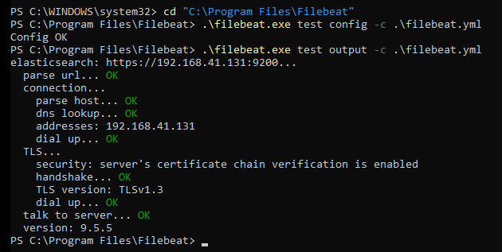

## Step 5: Run Filebeat as a service

```powershell
PowerShell.exe -ExecutionPolicy Bypass -File .\install-service-filebeat.ps1
Start-Service filebeat
Get-Service filebeat
```

**Screenshot:** `Get-Service filebeat` showing `Running`

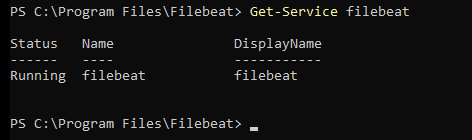

---

# Part 3: Verify the logs in Elasticsearch and Kibana

## In Elasticsearch (VM1)

```bash
sudo curl --cacert /etc/elasticsearch/certs/http_ca.crt -u elastic:$ELASTIC_PASSWORD "https://localhost:9200/filebeat-*/_count?pretty"
```

**Screenshot:** document count

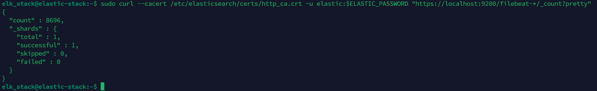

## In Kibana (`http://<VM1 IP>:5601`)

1. Open the menu and go to **Discover**.
2. Create a data view named `filebeat-*` with `@timestamp` as the time field.
3. Set the time range to cover all the days since OpenEDR was installed (for example the last 7 days).

**Screenshot:** the Discover table with the OpenEDR events

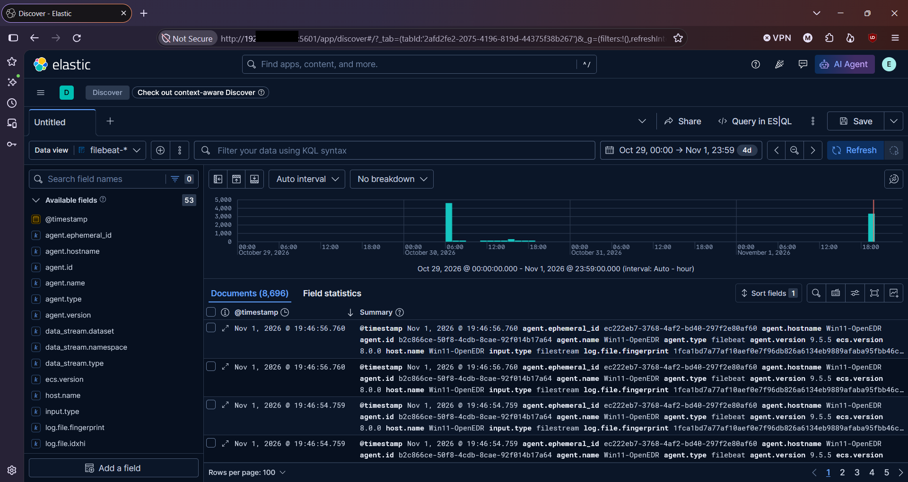

Kibana showed **8,696 documents**, which matches the Elasticsearch count. As a cross-check, count the lines in OpenEDR's log files on VM2:

```powershell
(Get-Content C:\ProgramData\edrsvc\log\output_events\*.log).Count
```

The result was **8596**. The two numbers are close but not identical, because OpenEDR keeps writing new events and the two counts were taken a few moments apart, while Filebeat ships new lines continuously. A small difference is expected on a live endpoint.

**Screenshot:** line count on VM2

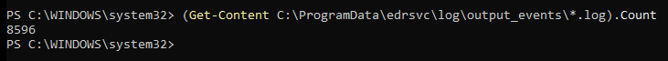

## Live test

Run `whoami` on VM2, then search in Discover for:

```
openedr.childProcess.cmdLine : *whoami*
```

The matching events from VM2 appear in Discover.

**Screenshot:** search results for `whoami`

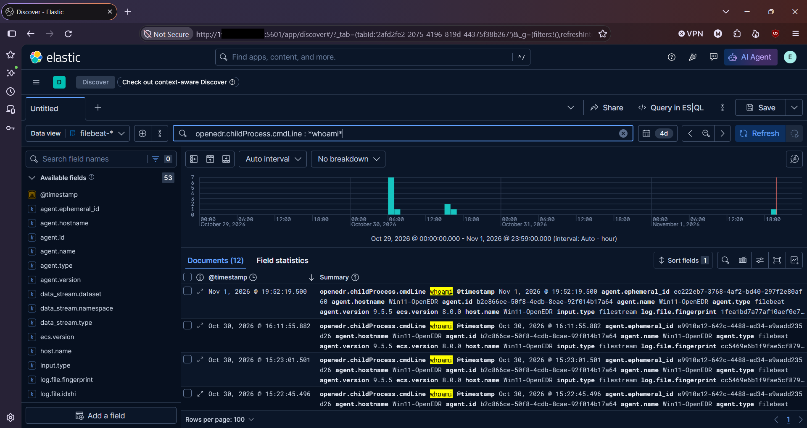

---

## Troubleshooting

- **No documents in Elasticsearch:** run `.\filebeat.exe test output -c .\filebeat.yml` and check `C:\Program Files\Filebeat\logs` for errors.
- **Cannot connect to port 9200:** make sure Elasticsearch listens on the VM's network address (`network.host` in `/etc/elasticsearch/elasticsearch.yml`) and that the firewall allows port 9200.
- **Indexing errors about numbers being out of range:** this is the 64-bit ID problem described above. Keep the `drop_fields` processor.
- **Kibana not reachable from another machine:** check `server.host: "0.0.0.0"` in `kibana.yml` and that port 5601 is open.

## Summary

OpenEDR on the Windows VM writes its endpoint telemetry to JSON log files. Filebeat reads those files and sends them securely to Elasticsearch on the Ubuntu VM, and Kibana shows the events. The setup was confirmed by searching for a command run on the endpoint. The same setup works for any further Windows endpoint by installing OpenEDR and Filebeat with the same configuration.

## Author

**Md. Jamal Uddin**
Junior SOC Analyst technical assessment, Bengal Infosec Limited
